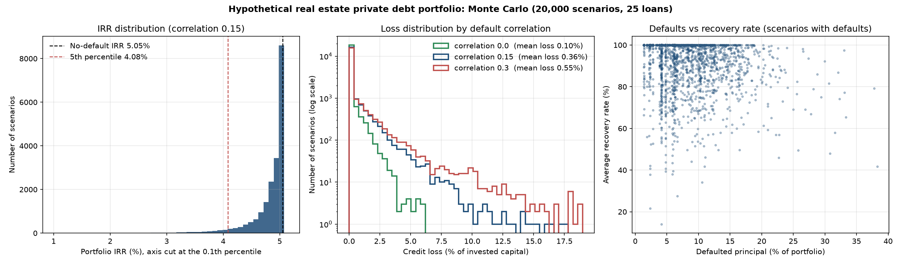

# Monte Carlo Simulation of a Hypothetical Real Estate Private Debt Portfolio

**All data in this project is hypothetical.** The loans are generated at random from the ranges listed below. They do not describe any real loan, borrower, fund or company.

## Question

How much does default correlation matter for the return and loss distribution of a diversified portfolio of real estate loans, when the expected number of defaults stays the same?

## Hypothetical portfolio

- 25 bullet loans in CHF: interest paid yearly, principal repaid at maturity
- Principal CHF 2 to 10 million per loan, maturity 2 to 5 years
- Loan to value (LTV) at origination between 50% and 75%
- Coupon rises with LTV: 4.0% + 8% x (LTV - 50%), so 4.0% to 6.0%
- Annual probability of default (PD) rises with LTV: 0.8% + 4% x (LTV - 50%), so 0.8% to 1.8%

The loan list is saved in `output/loan_tape.csv`. These pricing and PD rules are simple illustrative assumptions, not calibrated to market data.

## Contractual analytics (no defaults)

The script computes the cash flow schedule of the whole portfolio, its internal rate of return (IRR) and its Macaulay and modified duration.

## Monte Carlo simulation

Defaults follow a one-factor model. In each year a loan defaults if

    sqrt(rho) * Z + sqrt(1 - rho) * e  <  inverse_normal(PD)

where Z is a systematic factor shared by all loans, e is a loan-specific shock and rho is the asset correlation.

Recoveries depend on the property value. At default the collateral value is the original value (principal / LTV) times a price shock that is correlated with Z, minus 8% sale and legal costs, and capped at the principal. Property prices therefore tend to be low exactly when many loans default. Recovery is received one year after default, and no interest is paid in the year of default.

The simulation runs 20,000 scenarios for three correlation levels (0, 0.15 and 0.30). A built-in check compares the simulated number of defaults with the theoretical number, which does not depend on correlation.

Reported measures:

| Measure | Meaning |
|---|---|
| Expected loss | Average credit loss as a share of invested capital |
| Mean and median IRR | Average and middle portfolio IRR across scenarios |
| IRR 5th percentile | IRR that is exceeded in 95% of scenarios |
| P(IRR < 0) | Share of scenarios where the portfolio loses money |
| Credit VaR 99% | Loss level exceeded in 1% of scenarios |
| Expected shortfall 99% | Average loss in the worst 1% of scenarios |

## How to run

```bash
pip install -r requirements.txt
python private_debt_mc.py
```

The run takes a few seconds. Output is written to `output/`:

- `loan_tape.csv`: the hypothetical loans
- `mc_results.csv`: summary statistics for each correlation level
- `private_debt_mc.png`: IRR distribution, loss distributions by correlation, defaults vs recovery rate

The console prints the portfolio summary, the default check and the results table. Assumptions are at the top of `private_debt_mc.py` and can be changed.

## Results



Results for 20,000 scenarios at three levels of default correlation (hypothetical portfolio):

| | corr 0.0 | corr 0.15 | corr 0.3 |
|---|---|---|---|
| Expected loss | 0.10% | 0.36% | 0.55% |
| Mean IRR | 4.89% | 4.81% | 4.76% |
| Median IRR | 4.93% | 4.94% | 4.98% |
| IRR 5th percentile | 4.52% | 4.08% | 3.74% |
| P(IRR < 0) | 0.00% | 0.04% | 0.27% |
| Credit VaR 99% | 1.98% | 5.03% | 8.27% |
| Expected shortfall 99% | 2.85% | 7.63% | 12.83% |
| Mean defaults | 1.08 | 1.08 | 1.09 |
| P(at least 1 default) | 67.33% | 61.44% | 54.66% |

The average number of defaults is almost the same at all three correlation levels (1.08 to 1.09), but the loss distribution is not. Expected loss rises from 0.10% to 0.55% of invested capital as correlation goes from 0 to 0.30. In this model that happens because defaults cluster in scenarios where property values are also low. The tail changes much more than the average: credit VaR at 99% goes from 1.98% to 8.27% and expected shortfall from 2.85% to 12.83%. The median IRR rises slightly (4.93% to 4.98%) while the 5th percentile falls from 4.52% to 3.74%, and the chance of a negative IRR goes from 0.00% to 0.27%. Higher correlation also lowers the probability of seeing at least one default (67.33% to 54.66%), because the defaults are concentrated in fewer scenarios.

## Limitations

- Every assumption (PD, coupon, price shock, correlation, costs) is illustrative. Results depend strongly on them and should not be read as estimates for real loans.
- Bullet loans only. There is no amortisation, prepayment, extension, fees or reinvestment of cash flows.
- Annual time steps. The systematic factor is independent from year to year, so there is no persistent credit cycle.
- Property price shock and recovery are simplified, and the recovery delay is fixed at one year.
- The portfolio has no concentration by region, sector or sponsor, and PDs do not change over time.
- This is a teaching and portfolio project, not investment advice.

## References

- Vasicek, O. (2002). The distribution of loan portfolio value. Risk (one-factor default model).
- Frye, J. (2000). Depressing recoveries. Risk (link between defaults and recovery rates).
